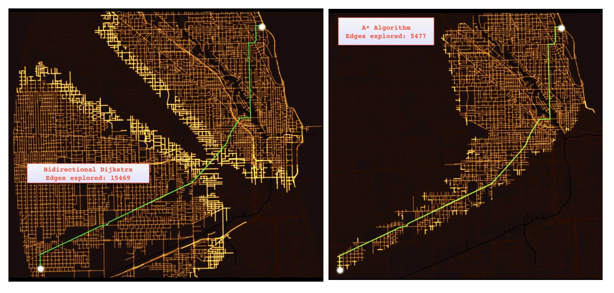
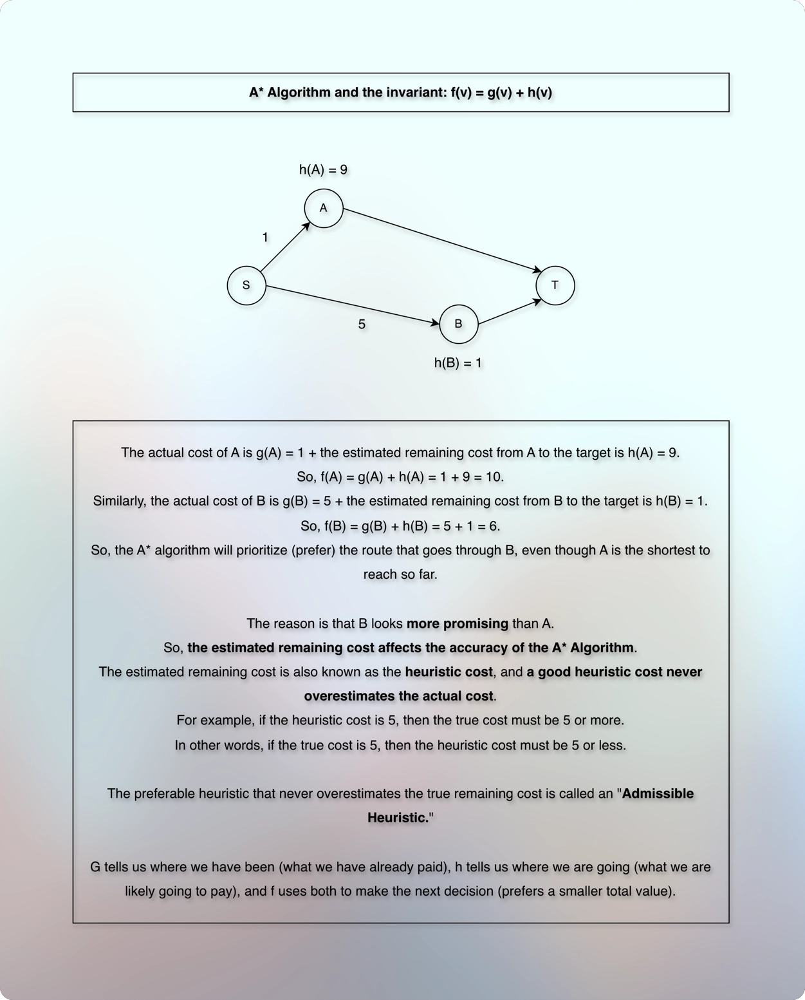
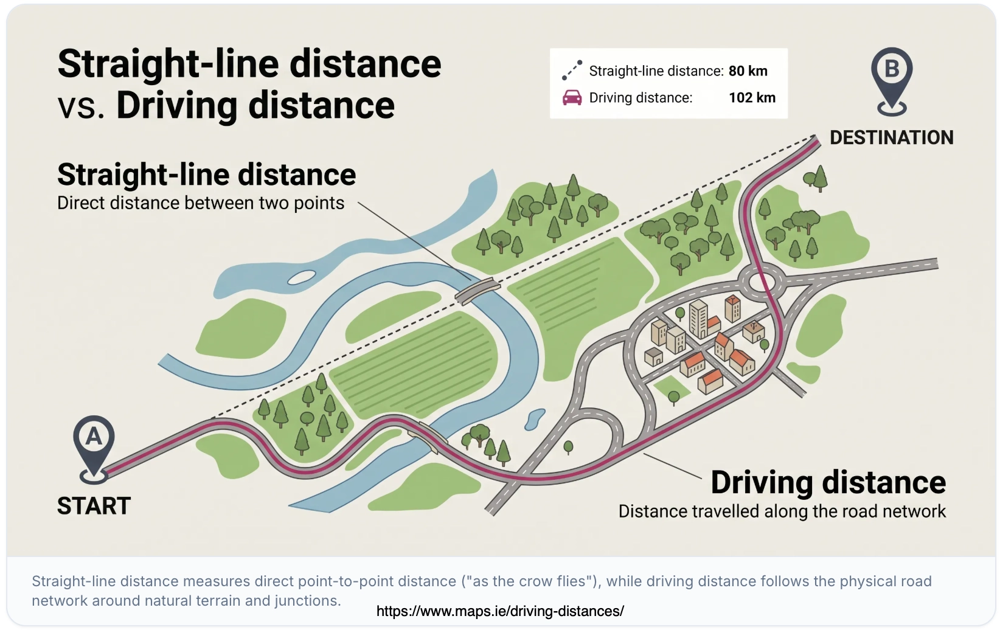
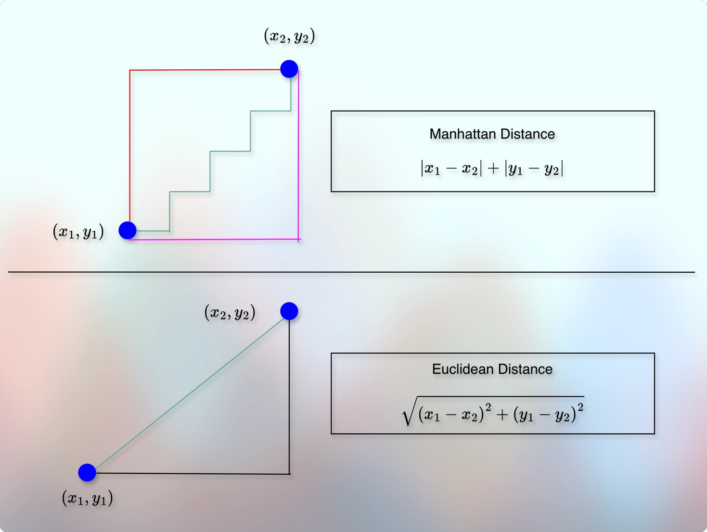

# A-Star (A*) Algorithm



* Reference: [PhysicsFX](https://youtu.be/JHgk9ZgHXjY?si=hAe_Dq11QiC_B6j0)
* The image is to help us visually understand the comparison of the bidirectional Dijkstra Vs. A* algorithm.



* An example of having an estimated value is when we have the co-ordinates of our current location, and the co-ordinates of the target location.
* Then, we can draw a straight line between our current location and the target location.
* And we ensure that our search does not go far away from that line.
---
* To remember the "Admissible Heuristic", we can use the below image:



* The straight-line distance is the "Admissible Heuristic."
* It never overestimates the actual distance.
* The actual distance is always higher (longer) than the Admissible Heuristic.
  * (The image source is: [https://www.maps.ie/driving-distances/](https://www.maps.ie/driving-distances/))
* If $h(v)$ is a heuristic (estimated) value, and $d^{*}(v, t)$ is the actual value from the vertex to the target that we do not know yet, then we prefer that: 
* $0 <= h(v) <= d^{*}(v, t)$ 
---
* Think of this as a triangle-inequality rule: 
* The estimate from a location to the destination cannot exceed the cost of taking one step to a neighbor plus the neighbor's estimate.
---
* A consistent heuristic satisfies a stronger condition for every edge from u to v:
* $h(u) <= weight(u, v) + h(v)$
---

| Heuristic | Admissible? | Consistent? | Can A* guarantee the optimal path?                                                                                |
|-----------|-------------|-------------|-------------------------------------------------------------------------------------------------------------------|
| A         | Yes         | Yes         | Yes                                                                                                               |
| B         | Yes         | No          | Yes, provided the implementation reopens vertices when better routes are found and uses correct termination logic |
| C         | No          | No          | Not in general; it may return a suboptimal path                                                                   |
| D         | No          | Yes         | Not possible under the standard definitions when $h(t)=0$ and edge costs are nonnegative                          |

---
* How do we choose a good heuristic?
* Normally, we get the heuristic from the input itself.
* But in general, a heuristic depends on the true meaning of the edge weight and movement rules (capabilities).



* For example, if the movement is possible only in four directions: up, down, left, or right, then we normally use the **Manhattan Distance** formula.
* $h = | x_1 - x_2 | + | y_1 - y_2 |$.
* It does not allow diagonal movement.
* For eight-direction movement where the diagonal movement is allowed, and each movement costs equal, we go with the **Chebyshev** heuristic.
* $h = max(|x_1 - x_2|, |y_1 - y_2|)$.
* When the straight-line (diagonal) distance between the source and the target, is lower bound, such as geometric movement with distance-based cost, we use the **Euclidean Distance**.
* $h = \sqrt{(x_1 - x_2)^{2} + (y_1 - y_2)^{2}}$
* And so on...
---
* Note that the A-Star algorithm without any heuristic values is the Dijkstra's Algorithm.
---

## Steps to code

* We start from the source. 
* So, the actual value `g(s)` will be `0`.
* We get the heuristic value of the source, `h(s)`.
* We calculate the total: `f(s) = g(s) + h(s)`.
* We update the `dist` value of the source.
* We add it to the priority queue.
* And as long as the priority queue is not empty, we repeat:
* We inspect the outgoing edges of the source.
* We try to relax each edge.
* For each edge relaxation, we update (add it to) the priority queue.
* To reconstruct the path, we also update the `parents`.
---
* For edge relaxation, we iterate through the edge list of a particular vertex.
* So, we need:

```kotlin

data class Edge(val to: Int, val weight: Long)

val adjList = List(totalVertices) { mutableListOf<Edge>() }

```

---

* We want to return the result with the distance and the path.
* So, we need:


```kotlin

data class Result(val distance: Int, val path: List<Int>)

```

---

* In the Dijkstra or Bidirectional Dijkstra's algorithm, the priority queue gets: `(distance, vertex)`.
* Here, we want to prioritize based on `f(v)`.
* And in case of tie, we also want to consider the actual distance, `g(v)`.
* So, the priority queue will get:

```kotlin

data class QueueItem(val fScore: Long, val gScore: Long, val vertex: Int)

```

---

* Note that `gScore` is our `dist` (actual distance value).
* So, the `gScore` will also help us remove the stale entries from the queue as we have seen in the normal Dijkstra and Bidirectional Dijkstra. 

---

* When do we stop?
* When we `poll` the `target` from the priority queue.

---

## Time Complexity

* Same as the Dijkstra's algorithm.
* But practical performance can be considerably, significantly efficient.
---
* Building the priority queue: $O(V)$
* A `poll` operation on the priority queue: $O(log V)$
* Total `poll` operations: $O(E)$
* Total cost of the `poll` operations: $O(E log V)$
* Total cost becomes: $O(V + E \ \log\ V)$.
* For a simple graph, $E <= V^{2}$.
* So, we can simplify the final time complexity as:
* $O((V + E) \ \log\ V)$.

## Space Complexity

* Same as the Dijkstra's algorithm.
* $O(V + E)$.
* That comes from adjacency list, `gScore`, `parents`, `priority queue`, etc.

## Implementation

* 

## Which one to use when

| Situation                                                           | Recommended algorithm                    | Why                                                                             |
|---------------------------------------------------------------------|------------------------------------------|---------------------------------------------------------------------------------|

## Questions

* What is h(t)? Why does it have to be 0? What does it imply?
* What happens when we get negative heuristics?
* Does it follow the same order of vertices as the Dijkstra's algorithm? Why?
  * No. It depends on the estimated value.
  * However, if the estimated value "h" is "0" for all the vertices, then it processes the vertices same as the Dijkstra's algorithm.
* Do we also call it "Directed search?"
* When to use: Dijkstra Vs. Bidirectional Dijkstra Vs. A* Vs. Bidirectional A* Vs. BFS, etc.?
