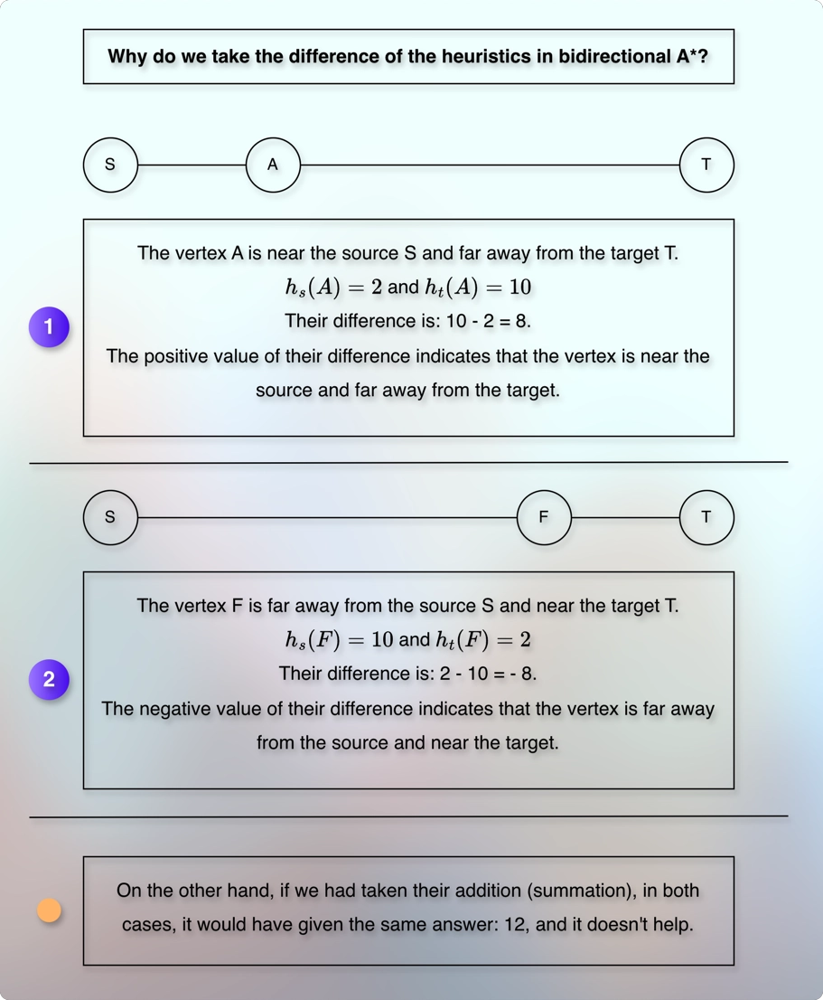

# Bidirectional A*

## Prerequisites

* [Dijkstras Algorithm.md](../../module04pathsInGraph02/010lectures/030dijkstrasAlgorithm.md)
* [Bidirectional Dijkstra.md](010bidirectionalDijkstra.md)
* [Bidirectional Astar.md](030bidirectionalAstar.md)

## Thought Process

* Let us recall the overview of the bidirectional Dijkstra's process.
* We search in two directions: Forward and backward.
* We take 2 arrays to store the distance: Forward and backward.
* We take 2 priority queues: Forward and backward.
* We store `(distance, vertex)` in each queue.
* The `distance` is the actual distance from the source vertex to the `vertex`.
* The distance associated with the polled vertex is the final.
* The vertex cannot get a smaller (shorter) distance than that.
* Also, if the vertex that we poll from one queue has a tentative distance stored in the relevant distance array of the other side, then:
* `forwardDist[u] + weight(u, v) + backwardDist[v]` = `complete path`.
* If this complete path is less than the shortest complete path found so far, then we update the global `min` or `shortestPathDistance` variable.
* It means that the global `min` is our upper bound, and it expects a lower value.
* Also, the item that we remove from the queue cannot be smaller than the previous item, because we do not allow negative weights.
* It means that the item that we poll from the queue is our lower bound.
* It says that "the next item cannot be smaller than me!".
* All these together, give us the stop condition:
* Stop when: `lowerBound >= upperBound`.
* I.e., stop when: `forwardDist[u] + weight(u, v) + backwardDist[v] >= min`.
* One of the critical parts that makes this possible is the fact that we store the actual distance in the priority queues.
* However, in the A* algorithm, we store:
* `f(v)`, which is `f(v) = g(v) + h(v)`.
* `f(v)` is not the actual distance.
* It means that we cannot conclude it definitely that adding `f(v)` of each priority queue will be the final and actual shortest distance.
* Think of this like having two different thermometers with different offsets.
* We cannot conclude the final actual temperature by adding their values.
* We must first handle the offset.
* In our case, heuristics are our offsets.
* It means that we cannot add pure and plain `f(v)` to each priority queue.
* We need to modify it in such a way that can give us a helpful mathematical guarantee about the lower bound.
* So, we need to add a modified `f(v)` to each priority queue.
* How do we do that?
* What do we do?
* We start with what we have.
---

* Recall the mathematical guarantee we used in the **find min from a stack using an array in O(1)** problem:

  * Reference: [Min Stack Using Array.kt](../../../../../../src/courses/uc/course02dataStructures/module01/section02stacksAndQueues/video01Stack/03MinStackUsingArray.kt)

* Similarly, we are looking for a mathematical guarantee when we peek the `min` in the priority queues.

---

* In the A-Star algorithm, each vertex gets two heuristics due to forward and backward search.
* For example, there will be two heuristics for vertex, v as below:

$$
\text{Forward search:}\ h_{S}(v)
$$

* It conveys the estimated remaining distance from the vertex, v to the target.

$$
\text{Backward search:}\ h_{T}(v)
$$

* It conveys the estimated remaining distance from the vertex, v to the source.
* So, they measure different things.
* They represent different things.
* They give different values.
* They have different goals.
* We want to align that.
* We want them to measure and represent the same thing.
* We want them to share a common goal.
* We can try to understand this with an analogy.
* Suppose that we have someone that reports the quantity in millilitre, whereas the other person reports the same quantity in liter.
* If we want to them to take a certain action when the quantity reaches a certain level, we need some mathematical transformation of their measurement units that they both can follow.
* In short, we need to align their measurement units, they both need to use the same measurement unit, so that they both can follow the common (shared) goal.
* Similarly, in our current situation, forward search moves towards the target.
* The forward search heuristics indicate the estimated remaining distance to the target.
* The backward search moves towards the source.
* The backward search heuristics indicate the estimated remaining distance to the source.
* If we want to share a common goal with them, we need some mathematical transformation.

---

* Suppose that a couple, A and B want to purchase a house.
* A wants to purchase the house near the target.
* We can think of it like the forward search.
* B wants to purchase the house near the source.
* We can think of it like the backward search.
* If they focus only on their own preference, they both end up with having two different choices.
* Let us assume that the source is at `0` and the target is at `100`.
* As A moves towards the target, their distance from the source is increased, and their distance to the target is decreased.
* Similarly, as B moves toward the source, their distance from the target is increased, and their distance to the source is decreased.
* Now, the house that is 10 km from the source, is 90 km from the target.
* If we take their total, `90 (distance from target) + 10 (distance from source)`, it becomes `100`.
* Similarly, the house that is 50 km from the source, is 50 km from the target.
* If we take their total, `50 (distance from target) + 50 (distance from source)`, it is still `100`.
* And if the house is 90 km from the source, it is 10 km from the target.
* And their total, `10 (distance from target) + 90 (distance from source)` is still `100`.
* In short, we will always get `100` if we take their total using the addition (summation).
* That's the constant heuristic.
* And a constant heuristic turns bidirectional A* into two individual Dijkstra.
* One might finish earlier than the other.
* But we don't get any benefits.
* In fact, we invest double, (two searches, two priority queues, etc.), but gets the same performance as of a normal Dijkstra.
* So, we need to change the way we are trying to align the two searches.

---

* Now, instead of taking their total, we try to take their differences.
* If the house is 10 km from the source, it is 90 km from the target.
* And their difference is `90 (distance from target) - 10 (distance from source) = 80` km.
* If the house is 50 km from the source, it is 50 km from the target.
* And their difference is `50 (distance from target) - 50 (distance from source) = 0` km.
* If the house is 90 km from the source, it is 10 km from the target.
* And their difference is `90 (distance from target) - 10 (distance from source) = -80` km.
* See the pattern.
* We are getting difference answers.
* And if we notice, if the house is near the source, we get a positive value.
* And if the house is in the middle, we get zero `0`.
* And if the house is near the target, we get a negative value.
* So, the difference gives us directional information.

---

**Differences of the heuristics**

* 

* Each vertex gets two heuristics: Forward and backward.
* For example, the vertex v gets: $h_{S}(v)$ and $h_{T}(v)$.
* Their difference is the potential for the vertex: $q(v) = h_{T}(v) - h_{S}(v)$.
* Why difference?
* Because:
* The positive value indicates that the vertex is near the source and far away from the target.
* The negative value indicates that the vertex is far away from the source and near the target.
* If the difference is `0`, it indicates that the vertex is in the middle.
* Hence, the difference gives us directional information.
* And it aligns with our directed search.
* Think of it like:
* We have the forward search estimation.
* We have the backward search estimation.
* And then we have their difference.
* The difference is the gap.
* The gap indicates how much they disagree with each other!
* So, the gap is the difference between the estimated values of the forward search and the backward search.
* It means that the potential of a vertex, v is:

$q(v) = h_{T}(v) - h_{S}(v)$

* What if we take their sum value?
* As we can see in the image, if we take their sum value, it naturally gives the same answer.
* For example, if $h_{S}(A)$ is 2, and $h_{T}(A)$ is 10, their sum is 12.
* For another vertex, if $h_{S}(F)$ is 10, and $h_{T}(F)$ is 2, their sum is also 12.
* So, it doesn't help as much as taking their difference help.
* This is the same reason we don't take their multiplication.
* What if we take division?
* //ToDo: Answer this!

---

* Using the subtraction (the difference) between the forward and backward heuristic, we get directional information.
* But we still have a problem.
* Suppose that the person A travels from the source towards the target.
* We know that as the person moves, their distance from the source increases and their distance to the target decreases.
* Initially, the person is at `0`.
* Now, suppose that the person travels 1 km from the source.
* So, we calculate it as: `99 (distance from target) - 1 (distance from source) = 98`!
* But the person has traveled only 1 km!
* The calculation or representation doubles the progress.
* It is tempting to think that if the result is double the expected value, then why not just cut it in the half?
* If we half the result, it becomes `49`, which seems worse.
* There is still something that we need to improve!

--- 

* Let us retry.
* We don't just half the result.
* We half the every single location.
* And we also adjust our perspective and interpretation.
* Initially, the person A is at the source.
* That is, `0` km away from the source, and `100` km away from the target.
* We calculate it as: $\frac{100 - 0}{2} = 50$, as a **shared value**!
* Now, the person moves 1 km away from the source.
* So, it becomes: $\frac{99 - 1}{2} = 49$, as a **shared value**!
* For 1 km of progress, we get exactly 1 km of difference in the **shared value**!  

---

> We may start from here. This is the only useful information we have.

* Now, the only information that we know about the heuristics is (or we expect, assume that) the heuristics are consistent, and they satisfy the below consistency condition:

$$
h(u) &le; weight(u, v) + h(v)  
$$
$$
h(u) - h(v) &le; weight(u, v)
$$

* The consistent heuristics convey that for the adjacent vertices (u, v), the difference of their individual heuristics cannot exceed their edge weight.
* For example, let us assume that moving from `u` to `v` actually costs us `5`.
* Then, the difference of their heuristics `h(u) - h(v)` cannot be more than `5`.
* So, if `h(u)` is `20` and `h(v)` is `25`, then it is consistent and admissible.
* But if `h(u)` is `20` and `h(v)` is `40`, then it is inconsistent.
* The entire approach of our bidirectional A* algorithm assumes that we get consistent and admissible (feasible) heuristics. 
* Using this information, we want to come up with some definite stop condition.

---

* So, it becomes:

$$
\text{For u}: h_{T}(u) - h_{S}(u) 
$$

$$
\text{For v}: h_{T}(v) - h_{S}(v)
$$

* And their difference becomes:

$$
|\ (\ h_{T}(u)  -  h_{S}(u) \ )\ - (\ h_{T}(v)  -  h_{S}(v) \ )\ |
$$

$$
|\ (\ h_{T}(u)  -  h_{S}(v) \ )\ | + |\ (\ h_{T}(u)  -  h_{S}(v) \ )\ |
$$

$$
&le; |\ weight(u, v) + weight(u,v)\ |
$$

$$
&le; 2\ ( \ weight(u, v) \ )
$$

* Using this condition, we want to stop when:

$$
&ge; 2\ ( \ weight(u, v) \ )
$$

---

* Now, the questions is, how do we accommodate and integrate this with our priority queue structure?
* Our goal is... // ToDo: Finish from here...

---

* Imagine that instead of the actual graph, we take a mathematical copy of it.
* We have some difficulties at the moment to properly measure the shortest path.
* Because each priority queue has `f(v)`, and the addition (summation) of each pure and plain `f(v)` does not give us a reliable `lower bound` for the stop condition.
* So, we take an adjusted graph.
* We will change certain things, but it is guaranteed that the optimal shortest path of the original graph will remain the same in the adjusted graph, too.
* In the adjusted graph, each vertex gets something called, potential.
* We can compare it with our actual (real) theory.
* The potential of the imaginary and adjusted graph is heuristic in our original graph.
* The heuristics of the original graph are consistent.
* So, our potentials must be consistent, too.
* It means that it must have some mathematical consistency.
* And this mathematical consistency is:

$$
w_{p}(u, v) = w(u, v) + p(v) - p(u)
$$

* It means that the adjusted edge weight is equal to the actual edge weight, plus the difference between the potential of the destination (ending) vertex of the edge and the potential of the starting vertex of the edge.
* Why this formula only? How did we come up with this formula? 
* How does that work?

---

* The reason behind this mathematical guarantee of the consistency is interesting.
* Suppose that our path is: S → A → B → T
* When we use the adjusted formula, we get:

$$
w(S, A) + p(A) - p(S) + w(A, B) + p(B) - p(A) + w(B, T) + p(T) - p(B)
$$

$$
w_{p}(S, T) = w(S, T) + p(T) - p(S)
$$

* The magical part is, almost all the potentials cancel out, and what remains is the actual edge weight + the difference between the target's potential and the source's potential!
* And this is the result of the adjusted graph.
* So, we can say that the value of the shortest path is the actual value + the difference between the target's potential and the source's potential.
* The shortest path itself of the original graph and the shortest path in the adjusted graph remain the same.
* Changing their numerical values consistently does not change the actual shortest path.
* But we cannot adjust the graph by any random, arbitrary values.
* We want to ensure that it does not produce negative edge weight.
* Because our algorithm does not work reliably when an edge can have a negative weight.
* So, how do we ensure that?
* Our potential formula is:

$$
w_{p}(S, T) = w(S, T) + p(T) - p(S)
$$

* We can re-write it in the general form to apply it on any vertex as below:

$$
w_{p}(u, v) = w(u, v) + p(v) - p(u)
$$

$$
|\ p(u) - p(v)\ | &le; w(u, v)
$$

* It means that the change in the potential while going from `u` to `v` can be up to (at most) $w(u, v)$.
* It aligns with our heuristic consistency.
* They both have the same form.
* We know the heuristic consistency, which is as below:

$$
h(u) &le; weight(u, v) + h(v)
$$

$$
h(u) - h(v) &le; weight(u, v)
$$

* How do we integrate this insight and information?
* We talked about the potential consistency and rules.
* But what will be the potential for each vertex?

---

* We know that in the bidirectional search, we take two searches.
* Forward and backward.
* Let us first try to visualize and understand it.

---

---

* Now, we are trying to connect and relate heuristics, potentials, their individual differences, etc. together to... (complete this.)
* We know that the potential must satisfy the below expression:

$$
|\ p(u) - p(v)\ | &le; w(u, v)
$$

* And we also know the heuristic consistency as below:

$$
|\ h_{S}(u) - h_{S}(v)\ | &le; w(u, v)
$$

* And it is true for the backward search, too.

$$
|\ h_{T}(u) - h_{T}(v)\ | &le; w(u, v)
$$

* And we know that:

$$
q(v) = h_{T}(v) - h_{S}(v)
$$

* Now, we want to know how much change we can get in the potentials while going from `u` to `v` so that (complete this... why are we trying to know this?)
* So, it becomes:

$$
q(u) - q(v) = |\ (h_{T}(u) - h_{S}(u)) - (h_{T}(v) - h_{S}(v))\ |  
$$

$$
= |\ (h_{T}(u) - h_{T}(v))\ | + |\ (h_{S}(u) - h_{S}(v))\ |  
$$

$$
&le; 2\ weight(u, v)
$$

$$
q(u) - q(v) &le; 2\ weight(u, v)
$$

* It means that the change in the potential while going from `u` to `v` be up to (at most) $2\ weight(u, v)$.
* But earlier, we derived that it can be up to (at most) $&le; weight(u, v)$ only.
* 

---

> //ToDo: Place this block at the right place.

**The seesaw analogy.**

* Suppose that side A is higher than side B.
* In other words, side B has more weight than side A.
* So, side B is near the ground and side A is far away from the ground.
* If we want to balance them both, what do we need to do?
* We add some weight on side A and remove some weight from side B.
* Similarly, to balance the things, we will add positive potential to the forward search.
* And we will add negative potential to the backward search.

---

## Questions

* How does the difference of the heuristic from the target to the vertex v, and from the source to the vertex, v help? Why did we take the difference instead of taking the addition that we do in the bidirectional Dijkstra? What causes this change? Is there any role of the heuristic consistency there (that the difference between the heuristic u and heuristic v must be equal to or smaller than the edge weight between u and v)? What role? Why do we have this consistency? What if the heuristics are not consistent? What if they don't satisfy this consistency? Or maybe we are trying to ensure consistent heuristics through these formulas and math for the definite point (stop condition). I believe the answer is in the term "balanced priorities." I am unsure. What does that term mean, what does it indicate, what is the importance of that term? 
* What do we mean by "balance the forward and the backward search around the same potential?"
* Why do we add the positive potential to the forward queue and the same negative potential to the backward queue? What does it indicate? What does it do? How does it help?
* How did we get the equations of the forward and backward queue? How do we justify those equations?  
* For the source vertex S and the target vertex T, we still apply the actual cost from the source to the vertex v + the actual cost from the vertex v to the target = the complete path. But I believe I am missing the idea that connects us with these actual costs. And I also believe that the complications (difficulties) come from the fact that we store `f` to the priority queue, and not merely the actual values. So maybe, all these formulas are to get idea of the actual values from the stored heuristics, but I am unsure. 
* Why do we have a different main while loop condition than the bidirectional Dijkstra? Why do we process even if one of the queues is exhausted/empty? What does that indicate? How does that help?
* I feel disconnected. I believe I am missing many things and hence, I am unable to connect with the implementation with proper reasoning and understanding. 
 
---

* How does taking the difference of the heuristics help? I understood what it indicates. And now I am trying to understand its importance, need, impact, and contribution to solution. What does it contribute to the solution? How does it contribute to the solution? It might be a part of the bigger picture that I might be missing.
  * Also, I am unable to connect (reason about) these two pieces: (1) It is one thing to understand the meaning of positive and negative potentials. I believe that the positive potential indicates that the vertex is near the source and far away from the target. Whereas, the negative potential indicates that the vertex is far away from the source and near the target. But (2) adding positive potential value to the forward queue search and adding negative potential value to the backward queue search, so that when we combine them, they cancel out each other (then why do we add them in the first place at all?), seems arbitrary (abstract, disconnected) to me.
* How did we take that p(v)? On what basis? How did we come up with that formula? Why that formula only? What does it indicate? Why do we use p(v)? How does it help? Does it indicate initial potential of any vertex or general potential of any vertex at any time? I believe it is to come up with some ground level information using which we can get a deterministic lower bound, but I am unsure.
* I believe there must be some reason behind our goal to come up with these formulas for the forward and backward search priority queues. For example, if we take the reference of the `min stack using an array in O(1)` example, we multiply the value by `2` whenever we get the value that is less than the current minimum. Because it is a mathematical guarantee that the value will be smaller than the current min. So that whenever we pop the item and if it is less than the current min, we understand that it is an encoded value. Once we find that it is an encoded value, we can restore the previous minimum to the global `min` variable using the encoded value. Similarly, I believe there must be some concrete reason (maybe a mathematical guarantee or something else) behind these formulas. They might be establishing some guarantee.
* What is the general, overall idea, intuition, inspiration, and association principle for this entire process? I believe we are doing this process to come up with a reliable, deterministic, and confident stopping condition. But I am unable to connect all these different pieces together.
* I believe it all starts with this consistency guarantee: $h(u) &le; weight(u, v) + h(v)$. Which is, $h(u) - h(v) &le; weight(u, v)$. I believe that consistent heuristics convey that: "The difference of the individual heuristics of two adjacent vertices cannot exceed their edge weight." So, we might want to come up with a relevant stop condition. If we want to start from this information, and build all the other formulas and connections, including the formulas of forward and backward search priority queues, how do we do that? Using this information, we want to come up with some definite stop condition. Start from what we already know using the association principle. Use metaphors, analogies, oversimplification, non-technical examples, layman's language, and then model each point into the actual technical explanation and implementation, step by step, with justification. I believe this will work for me. This will help me connect everything and make sense of everything. I believe this will help me understand why we do what we do.
* Why did we choose p(v) as the half of the q(v)? How does it help?
* How did we come up with this priority formula where we multiply the actual distance by 2 and then add either the positive potential or the negative potential? Why do we multiply the actual distance by 2? How does it help?
* Why don't we do something like we process by f(v), but we make the stop condition same as the bidirectional Dijkstra by using the actual distance (`gScore`) of the priority queue's item? I believe the reason is that the entire A* algorithm is based on and uses the estimated values (heuristics) to guide the search and to determine the actual shortest path. Now, I believe that there is a possibility that the next (or any subsequent) item with higher heuristics (potential) has (can have) the shortest path. Although, I am unsure about my understanding (Is it true? How?) to this question.
  * Also, ultimately, the forward min priority + backward min priority ends up with the actual value only. Then, why don't we directly use the `gScore` (actual distance)? 
* I understand that this process requires consistent heuristics. In general, do we get consistent heuristics or inconsistent heuristics? What will be the solution for the inconsistent heuristics? Start from what we already know using the association principle. Use metaphors, analogies, oversimplification, non-technical examples, layman's language, and then model each point into the actual technical explanation and implementation, step by step, with justification.
* We may need to take actual values using the simplest possible graph to understand the stop condition.

---

* Are heuristic and potential the same thing? It seems that they are different, but I mixed them and treated them as one! I used them interchangeably! What is the difference between them? How do they relate to each other? Are we trying to imagine that the original graph has heuristics, but the adjusted graph has potentials? Are we trying to say that in the original graph, we have actual edge weights and each vertex has a heuristic value. Whereas, in the imaginary graph, we have adjusted edge weights, and each vertex has a potential? How does having potentials instead of heuristics help? How does this transformation (even though if it is imaginary or a mathematical copy or whatever) help? Or are we trying to say (convey, proof) that the original graph is already a mathematically transformed graph where we can consider heuristics as potentials?  
* Regarding: p(v) - p(u) <= w(u, v) How did we conclude that to avoid any negative edge weight, the potential difference must be less than or equal to the edge weight?
* What is the difference between p(v) and q(v)? How do they relate? What do they convey? The potential of a vertex v is p(v) or q(v)? Are we using it interchangeably?
* Why did we try to know the difference between q(u) and q(v)? Where do we want to reach? What is the role of knowing this into the final stopping condition?
* When you said that "We have discovered a problem: the difference \(q\) can change by as much as \(2w\), but our potential needs to change by at most \(w\). What should we do? Divide by two:" and then you used the expression: $p(v) = \frac{h_{T}(v) - h_{S}(v)}{2}$, but we only derived and explained $q(v) = h_{T}(v) - h_{S}(v)$. So, from where and how did we derive this p(v) expression, even without the factor $\frac{1}{2}$? Or did we just replace q(v) with p(v) and then added the factor $\frac{1}{2}$ to come up with the definite expression (for what?)? I am disconnected here.
* I understand that in the normal A* search, we use `f(v) = g(v) + h(v)`. Here, we use `f(v) = g(v) + p(v)` for the forward search, and `f(v) = g(v) - p(v)` for the backward search, where $p(v) = \frac{h_{T}(v) - h_{S}(v)}{2}$. If this is true, then our goal is to reach from `h(v)` to its replacement `p(v)` step-by-step. Start from what we already know using the association principle. Use metaphors, analogies, oversimplification, non-technical examples, layman's language, and then model each point into the actual technical explanation and implementation, step by step, with justification.
 
---

**To: Google Gemini**

* In your example, you said that for 1 mile, the calculation resulted in 98, and concluded it as 2 miles!
* And as a solution, you said, half the result, but that makes it even worse, 49!
* So the calculation interpreted 1 mile as 51 miles!
* Then why do we go with that solution?

---

//ToDo: Add questions to confirm our understanding.
