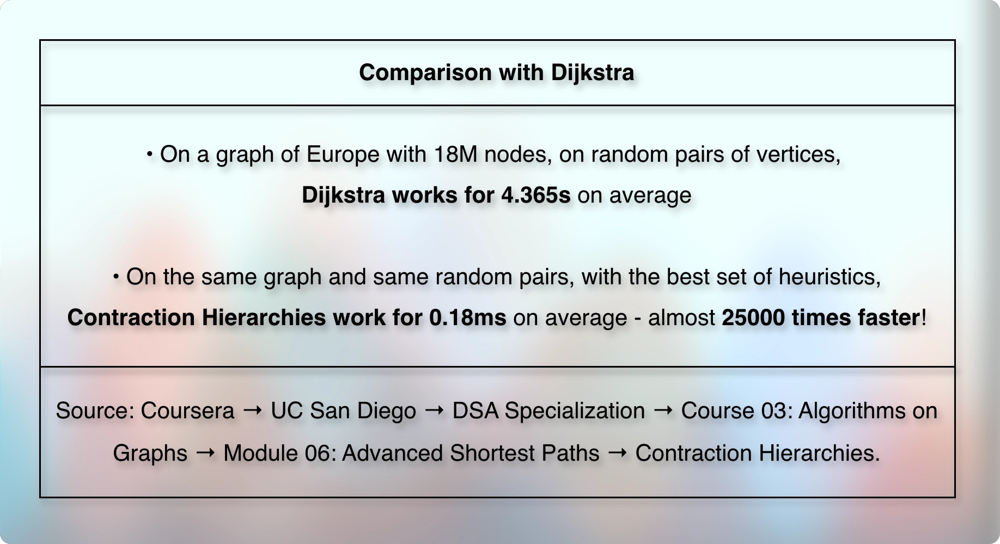
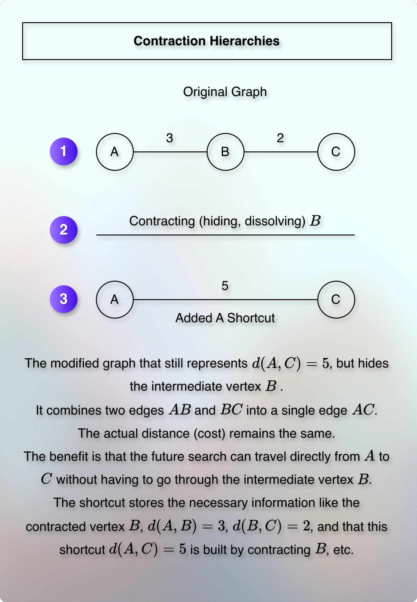
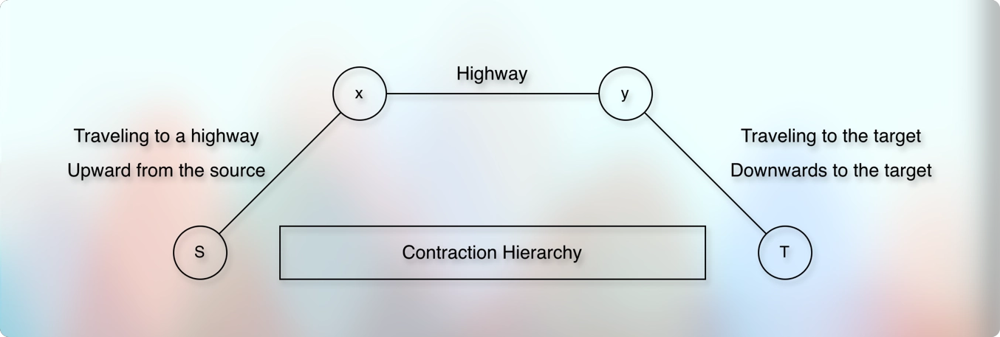
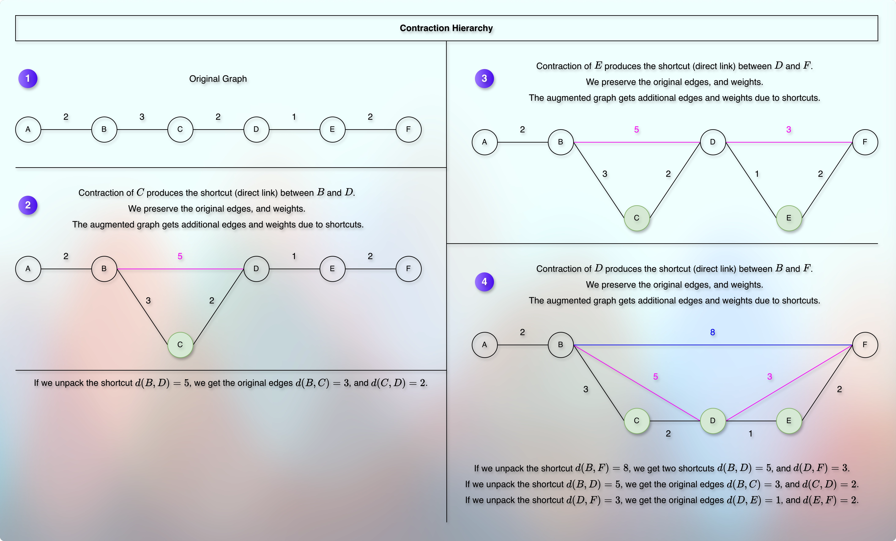
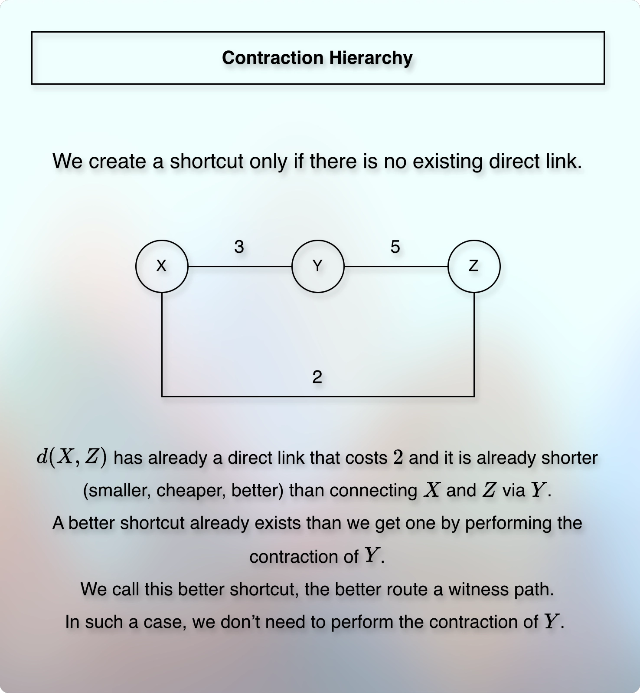
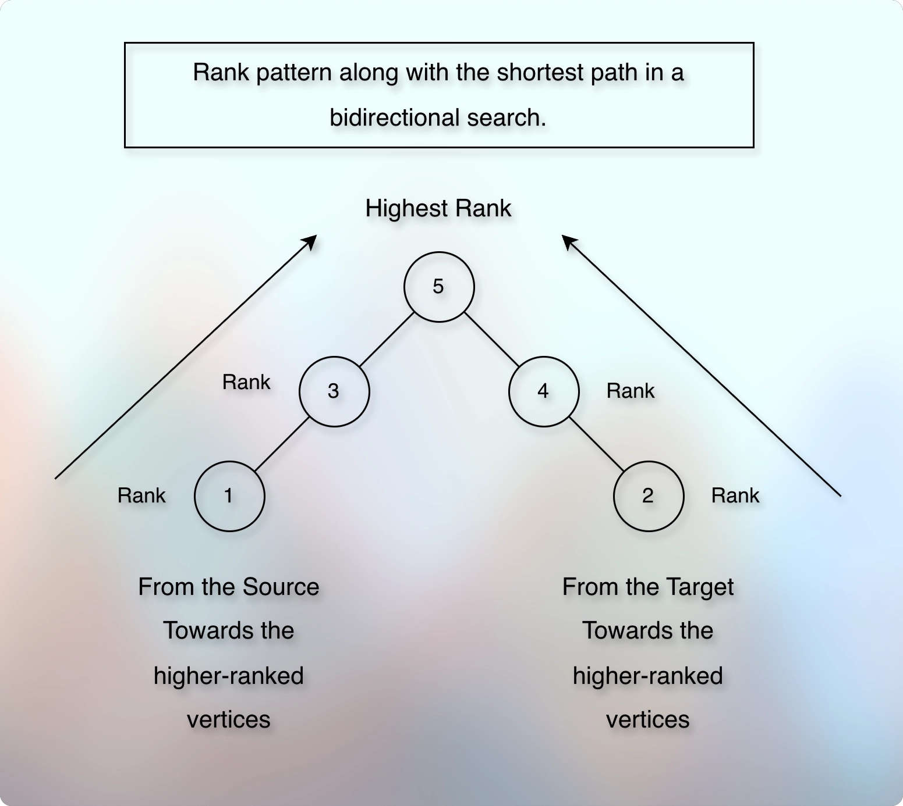
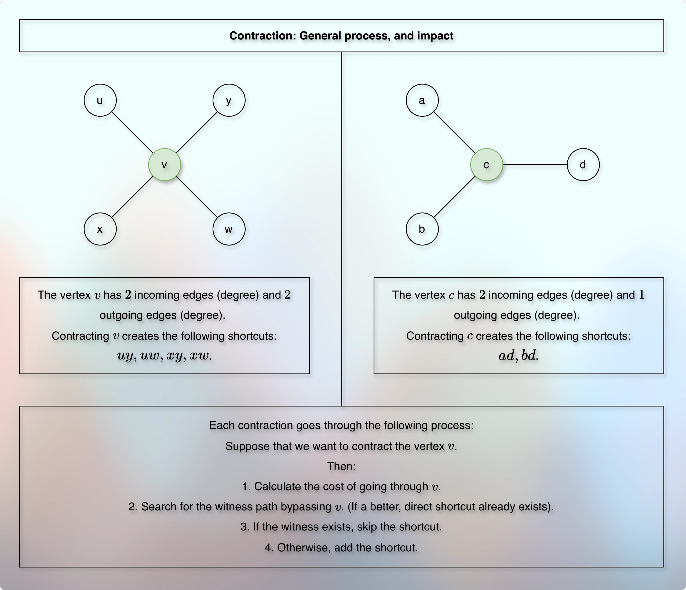
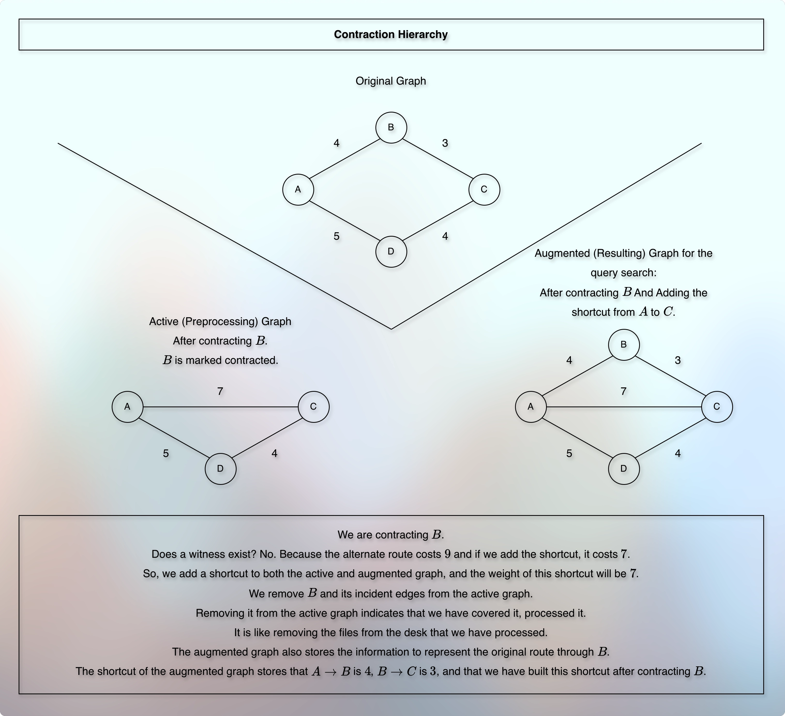

# Contraction hierarchies and node importance

---

**References**

* [Illustrative Contraction Hierarchies By System Underground](https://youtu.be/xe1CbmJfMcU)

---

* The main purpose of the contraction hierarchy is to preprocess and prepare the map beforehand so that finding the shortest path becomes faster, and it also reduces the search space.
* We need to preprocess and prepare the map beforehand for the multiple queries.
* We don't know the future source and the future target.
* And there can be different source and target for different queries.
* So, how do we preprocess and prepare the graph (map, network)?

---

* We compare contraction hierarchies with a flyover (overpass).

* The first and the third image represent the idea.
* Suppose that there are 10 vertices between a source and a target.
* We find the shortest path between this source and the target.
* We store this information.
* Later, when we ask (once or frequently), we do not have to recalculate it every time at runtime on demand.
* We compare this with an analogy where we travel from a source to a destination via a flyover (overpass, highway) instead of going through the local villages, tolls, and signals.
* If there is no flyover (overpass), we build one. 
* We can think about the preprocess as if we use this flyover information to build an index (table of content).
* So that later when we want to know the distance (page number) of a particular chapter (vertex), we already have a ready-made answer.
* The index (table of content) shows only the titles, and hides other details.
* But that doesn't mean that those details are gone.
* The details still remain in the book.
* The huge benefit is that we don't have to start from the first page for every search query.
* The index (table of content) acts as a guided search.
* And it makes each search query faster.
* So technically, what do we do? 
* And how do we do it?

---

* What happens when we travel from our home, which is in a different state to a friend's home, which is in another state?
* We start with the local streets, then enter into a highway, then a bigger highway, maybe an interstate highway. 
* And as we reach closer to the friend's home, we enter into the smaller highway, and eventually, into the local streets.
* This is the general pattern and inspiration for the intuition.

1. Leave residential street.
2. Enter into the main road.
3. Join a state highway.
4. Join a national highway.
5. Leave the highway as we reach near the destination.
6. Travel through the local roads to reach the destination.

* The journey starts and ends on local roads.
* But the long distance journey happens on highways.
* We can classify them roughly as:

1. Local roads near the source and destination.
2. Regional roads that connect highways.
3. Highways that cover the major distance.

* We want to focus on the highway that connects the regional road that connects the local road to the source and the destination.
* But how do we apply this filter?
* Based on the importance.
* We want to focus on the local roads near the source that connect regional roads that connect highways that connect regional roads towards the target that connect the local roads near the target.
* If a local road near the source does not connect a regional road or a highway that can reach the target, it is not important to us.

---

**The contraction process overview**

* Suppose that we receive a huge road network.
* We want to preprocess and prepare the graph in advance for the shortest path queries.
* But we don't know the future source and the future target yet.
* And there can be many different sources and targets in different queries.
* Each query can have a different source and a different target.
* So, we cannot simply delete a vertex.
* But we can build flyovers between different vertices.
* It does not destroy the existing edges.
* It adds more edges, and we call them shortcuts.
* Instead of deleting a vertex, we contract (hide, bypass) it.
* But before contracting a vertex, we check various things.
* Such as routes passing through it.
* Because if there are more routes passing through it, it means that the dependency of the vertex is more.
* In other words, more neighbors depend on this vertex.
* And if we contract (hide, bypass) this vertex, we will need more shortcuts for the neighbors.
* More shortcuts means more edges.
* So, to optimize this process, we check whether the already better shortcut exists.
* We call it witness search, and we provide a limit to the witness search.
* The witness search helps us determine whether there is already a better shortcut exists.
* And the limit we provide to the witness search defines how long (how much) we want to search.
* This limit impacts the efficiency and search performance.
* Higher the limit, more the accuracy.
* Lower the limit, unnecessary shortcuts.
* We balance.
* We prefer unnecessary shortcuts over accidentally losing existing shortest paths.
* We add the shortcut only if there is no better shortcut exists.
* Also, we do not select the vertices for the contraction arbitrarily.
* We add vertices to the priority queue based on their importance.
* The importance is the sum of edge difference, contracted neighbors, shortcut covers, and node level.
* Edge difference of the vertex `v` $ed(v)$ is the sum of new shortcuts we add, incoming edges to `v` we remove, and the outgoing edges from `v` we remove.
* We denote new shortcuts we add if we contract `v` as: $s(v)$
* We denote incoming edges to `v` as: $in(v)$
* We denote outgoing edges from `v` as: $out(v)$
* Then, if we contract `v`, then the edge difference is: $s(v) - in(v) - out(v)$
* The edge difference answers: How many new edges do contracting the vertex leave behind?
* So, we prefer the smaller value of the edge difference.
* Contracted neighbors of the vertex `v` $cn(v)$ is the number of already contracted neighbors of the vertex `v`.
* A vertex with a fewer already-contracted vertex receives a better score.
* The $cn(v)$ answers: How many neighbors of the vertex `v` are already contracted?
* The shortcut cover of the vertex `v` $sc(v)$ answers how many shortcuts we may need to add if we contract the vertex `v`.
* If there are more vertices (neighbors) whose paths go through `v`, then the dependency of the vertex `v` is more.
* It means that if we contract `v`, we might have to add more shortcuts.
* Adding more shortcuts means adding more edges.
* Having more edges means having a higher processing and calculation time.
* So, we prefer a smaller value for the $sc(v)$.
* The level (depth) of the vertex `v` is $L(v)$, and it represents the reachability of the vertex `v`.
* $L(v)$ represents (answers) the maximum time (upper bound) we may need to reach the vertex `v`.
* The importance of a vertex `v` $I(v)$ is the sum of these four values:
* $I(v) = ed(v) + sc(v) + cn(v) + L(v)$.
* Based on this importance, we add vertices to the priority queue.
* Then, we extract the vertex having the least importance.
* Contract and add required shortcuts.
* Contracting a vertex can:
  * increase the number of shortcuts its neighbors require.
  * increase the already-contracted neighbors.
  * change the node level.
  * change the edge-difference.
* Update affected vertices.
* Recalculate the importance after the contraction.
* Compare its updated importance with the current `min` of the priority queue.
* If it is still the least important, contract it.
* Otherwise, put it back to the priority queue with its updated importance.
* Repeat until we contract all the vertices.
* The order in which we contract the vertices is called, Node Order.
* The position of the vertex in this Node Order is the Rank of the vertex.
* The augmented graph will have all the original edges, connections, and additionally, shortcuts.
* We also record the order in which we contract the vertices (Node Order).
* And we also record the rank of each vertex.
* This is how we preprocess the original graph and transform it into an augmented graph.
* Once we are done with the preprocessing, we process the actual queries.
* The query algorithm uses bidirectional Dijkstra.
* Each query uses ranks.
* The query algorithm uses the rank to search only in the upward direction from both the end-points (searches).
* In this way, we expect to get much smaller search space.

---

* How do we assign the importance?
* Highways cover the most distance. So, they get the highest importance.
* Regional roads that connect highways get the middle importance.
* Local streets that connect regional roads get the lowest importance.

---

* How do we find (define, evaluate, calculate, determine, and assign) the importance? 

---

* Shortcuts add more edges to the augmented graph.
* The number of shortcuts depend on the contraction order.
* The contraction order depends on the ranks.
* So, the way we define the ranks decides plays critical role in the search performance.

---

* Suppose that `V` represents the locations (vertices).
* And `E` represents the roads (edges) that connect these locations (vertices).
* These `V` and `E` are parts of our graph, `G`.

$$
G = (V, E)
$$

* And if `u` and `v` are two locations, then the cost of traveling from `u` to `v` is:

$$
w(u, v)
$$

* The cost can be any unit.
* Such as distance, fuel, price, toll-tax, time, etc. 

---

**Contraction Hierarchies**

* What if we preprocess the graph to find the shortest path?
* But we don’t know the source and the destination beforehand.
* Also, there can be millions of vertices.
* It is not feasible to find the shortest path for all the vertices from all the other vertices.
* The concept we use to solve the problem is called contraction hierarchies.
* We virtually remove intersections, obstacles, stops, etc.
* But we preserve the path.
* We assign a rank to each vertex based on the importance.
* We record an order in which the vertices are visited.
* We do this for all the vertices, for the entire graph.
* This process is called preprocessing.

---

* In contraction hierarchy, we contract (hide) an unimportant vertex (like vertex B in the image) and connect its neighbors directly (like A and C in the image).
* Here, the term hierarchy represents ranking of nodes from least important to most important.
* The idea is:
* Identify the least important intersections.
* Bypass them.
* For example, the vertex B in the image.
* Do not destroy the shortest route.
* For example, $d(A, C)$ is still $5$.
* We do not delete or remove the vertex, $B$.
* We just hide it.
* The vertex $B$ is the part of the route (path) $AC$.
* The path $AC$ goes through $B$.
* If we remove (delete) the vertex $B$ in reality, then we break the route $AC$.
* Also, we cannot delete a vertex arbitrarily.
* Because for some query, $B$ can be a source, a destination, or a part of the path.
* So, we don't delete the vertex $B$.
* We just hide it.
* We call it **vertex contraction** or **node contraction**.
* After the vertex contraction, we may need to create a shortcut.
* Creating the corresponding shortcut is a possible consequences of the vertex contraction.
* For example, after we contract (hide) the vertex $B$, creating a shortcut that connects the vertex $A$ and $C$ is essential.
* The shortcut must preserve the original cost.
* For example, the shortest path $d(A, C)$ from $A$ to $C$ that goes via $B$ in the original graph costs $5$.
* So, in the modified graph also, after contracting (hiding) $B$ and creating the shortcut (direct connection) $AC$, the shortest path $d(A, C)$ still costs $5$.
* However, sometimes the vertex contraction does not require creating a shortcut.

---

* The order in which we select and perform contractions on the vertices matter.
* It can change the shortcuts (start-vertex and end-vertex), the number of shortcuts, the number of edges in the augmented graph, preprocessing time and efficiency, etc.
* For the efficient order, we use node importance (rank).
* For example, a road that connects a highway is more important than the road that connects a small local street.
* We generally contract the less important vertices first.
* The vertices that we contract before (earlier) get lower ranks.
* The vertices that we contract later get higher ranks.
* In this way, the rank of a vertex $r(v)$ represents the position of the vertex in the contraction order.
* We may or may not know the importance (rank) of each vertex in advance.
* But we estimate it using the characteristics of the graph.
* How?

---

* Which vertices do we identify as intersections?
* Based on the importance (rank).
* How do we define and assign the importance (rank)?
* How do we ensure that we do not destroy the shortest route?

---

* Contraction hierarchies do not discover and identify intersections.
* It is something that we get beforehand as a part of the input.

|    Real-world element   |    Graph representation    |
|:-----------------------:|:--------------------------:|
| Road intersection       | Vertex                     |
| T-junction              | Vertex                     |
| Roundabout connection   | Vertex or several vertices |
| Road segment            | Edge                       |
| Travel time or distance | Edge weight                |
| One-way road            | Directed edge              |

* We generally create vertices at locations that matter for routing, such as:
* Road junctions
* Changes in connectivity
* Road endpoints
* Places where a route can enter or leave a road
* Places that change the route
* Etc.

* The exact graph construction is a separate preprocessing step that happens before contraction hierarchies.

---

* The goal is to prepare a preprocessed map that knows important routes (paths) vs. unimportant routes (paths).
* How do we define and assign important vs. unimportant paths?
* How do we define and assign ranks?
* Do we define and assign ranks based on the distance (edge weight)? How?
* Does the higher edge weight get the higher rank?
* How do we use ranks?
* How do we treat different ranks?
* How does the map treat and use different ranks?

---

* Do we take the least important intersections, and hide them?
* Does it mean that we hide the vertices with the lowest rank?
* How do we hide/bypass/treat vertices or edge-weights with the lowest ranks?
* What if a vertex is a part of the shortest path? Do we still hide it? How? Why?
* What does it mean by building/creating a direct mathematical bridge/shortcut? How does it help? When do we do that? Why do we do that? How do we do that?
* In which case a vertex contraction does not require creating a corresponding shortcut? Why?
* When do we skip building/creating a shortcut? Why?
* Suppose that the original graph has edge(A, B) with weight 3, edge(B, C) with weight 2.
* Now, do we preprocess the graph such that it answers:
* "The shortest path from A to C goes via B and A to C costs 5".
* If yes, how?
* If no, then what does it answer? How?
* Can we say that the preprocessed graph (map) is a zoomed out version of the original graph (map)?
* If yes, then how does it help?
* Do ranks act as a guide for the search? How?
* How does the representation of the shortest path as upward from the source and downward to the target help? Why isn't it a linear path?

---

* What is a witness search?
* What is a witness path?
* What is a witness limit / search limit?
* For the given contraction example of 2-6-1-4-3-5, where the edge weight is 2,3,2,1,2 respectively:
  * Why didn't we perform contraction of `6` that could have created the direct connection (shortcut) between `2` and `5` with cost `10`?
  * We performed the contraction of `2`, but not for `6`. Was it possible (legal) to perform the contraction of `6` before `2`? Why? 
* Do we add the shortcut only if there is no existing direct connection (link)?
* Do we add the shortcut if the direct connection (link) between two vertices has larger value than the alternate route via one or more vertices? 
  * For example, suppose that `edge(u, v)` is `3`, `edge(v, w)` is `2`, and `edge(u, w)` is `8`.
  * Here, the direct connection (link) between `u` and `w` already exists.
  * But it is costlier than the alternate route that connects `u` and `w` via `v`.
  * So, do we perform contraction on `v` and add a shortcut (direct link) `edge(u, w)` that costs `5`? Why?
* Does witness path mean direct connection (link)?
* Isn't it true that finding the witness path to decide whether we need to create a shortcut or not means running Dijkstra from one vertex to another vertex? And we might do it for all the vertices. And in this way, isn't it expensive as we might run Dijkstra on each vertex instead of one fixed source and one fixed target? Doesn't it seem to be exponential (polynomial) as we might run Dijkstra $V^2$ times?
* 
---

**Recap**

* We imagine the idea of contraction hierarchies as a flyover (overpass).
* The term “contraction” refers to the process of reducing the number of nodes in a graph.
* We hide less important nodes and edges, making the graph simpler.
* But they are still there, just hidden.
* The term “hierarchies” refers to the process of organizing nodes based on their importance.
* To organize nodes based on their importance, we use ranks.
* We use ranks to guide the search process.
* We imagine the search process as moving upwards from the source and downwards towards the target.
* Moving upwards from the source indicates moving through the higher-ranked nodes.
* Similarly, moving downwards towards the target indicates moving through the lower-ranked nodes.

--- 

**How do contraction hierarchy and ranks help?**

* It makes the query for the shortest path faster.
* How?
* The hierarchy is designed (implemented) so that the shortest path gets a specific pattern:

> Increasing importance → Highest importance → Decreasing importance
 
* For example, the shortest path might get the following rank order visit:

> 1 → 3 → 5 → 4 → 2

* How does the shortest path get that order? How does that help?
* It indicates that for any source and any target, the augmented graph has the shortest path whose first portion is increasing in rank, and the second portion is decreasing in rank.
* How does the augmented graph get that pattern? How does that help?
* This characteristic makes bidirectional search faster.
* How does this characteristic make the bidirectional search faster?
* When we apply this to the bidirectional search, both the searches move towards the higher-ranked vertices.
* Each search gets very specific goal, direction, and pattern.

---

**Incoming and outgoing edges (degree)**

* A vertex might have different numbers of incoming and outgoing edges.
* And this matters for the contraction.
* Different number of incoming and outgoing edges can produce different consequences of the contraction.
* And ultimately, different contraction consequences can have different search performance.

---

**Symbols**

* $s(v)$: Number of shortcuts added.
* $in(v)$: Incoming degree = Incoming edges of the vertex $v$.
* $out(v)$: Outgoing degree = Outgoing edges of the vertex $v$.

---

**Edge Difference: $ed(v)$**

* We want to minimize the number of edges in the augmented graph.

---

* How is it possible that adding a shortcut can remove incoming and outgoing edges?

---

* Suppose that contracting a vertex:
  * Adds 5 shortcuts.
  * Removes 3 incoming edges.
  * Removes 3 outgoing edges.
* Then the edge difference is:

$ed(v) = s(v) - in(v) - out(v)$

$ed(v) = 5 - 3 - 3 = -1$

* It indicates that the total number of edges are decreased by 1.
* The edge difference answers: How many extra edges will this contraction leave behind?
* If the edge difference is small, contracting the vertex is attractive from the perspective of the graph size.
* The smaller the edge difference, the fewer the edges, the faster the search performance.

---

* Why contracting all the vertices of one particular region before touching another region makes the contraction hierarchy unbalanced?

---

**Symbols**

* $cn(v)$ = Contracted neighbors of the vertex $v$.
  * A vertex with a fewer already contracted neighbor vertices receives a better score under this criterion.
  * Contracted neighbors answers: How many of my neighbors have already been contracted (removed, hidden)?
* $sc(v)$ = Shortcut cover: Number of shortcuts the neighbors (of the vertex $v$) require to or from (via) the vertex $v$. 
  * Number of shortcuts the neighbors of the vertex $v$ require + The shortcuts that pass through the vertex $v$ (for the neighbors of the vertex $v$).
  * If this number is large, it means that many neighbors depend on the vertex $v$ for their corresponding shortcuts.
  * The shortcut cover answers: How many neighbors would require new connections (shortcut) if I disappear?
  * We prefer (or prioritize) the smaller shortcut cover.
  * It means that we first contract the vertices having smaller shortcut cover.
  * Recall that each contraction has the possibility to create a new shortcut edge.
  * And preferring (prioritizing) the smaller shortcut cover means an attempt to introduce (produce) a fewer new shortcut edges.
  * If we have a fewer edges in the augmented graph, then the search performance becomes faster.
  * 

---

* Why do we say that a vertex having a fewer already contracted neighbors receives a better score? How?
* Why do we want to avoid creating large (long) upward paths in the hierarchy?

---

**Symbols**

* $L(v)$: Node level: An upper bound on the number of edges require to reach the vertex $v$ from any source in the augmented graph.
  * In simple words: We will need a maximum of $L(v)$ number of edges to reach the vertex $v$ from any source (in the augmented graph).
  * It indicates the depth of the vertex $v$ in the hierarchy.
  * We prefer contracting the vertices with the smaller node level.

---

* What is the difference between the shortcut cover and the node level?
* Why do we say that initially $L(v) = 0$?
* After contracting the vertex $v$, how does it become: $L(u) = maxOf(L(u), L(v) + 1)$? (Where `u` is the neighbor of `v`).

---

**Importance**

* $ed(v)$: Edge difference: We prefer a smaller value.
* $cn(v)$: Already-contracted neighbors: We prefer a smaller value.
* $sc(v)$: Shortcut cover: Neighbors depend on `v`: Possible shortcuts require: We prefer a smaller value.
* $L(v)$: Depth: Reachability: We prefer a smaller value.
* If we denote the importance of the vertex `v` as $I(v)$, then:

$I(v) = ed(v) + cn(v) + sc(v) + L(v)$

* We contract the vertex with the smallest importance first.

---

**How do we use the importance?**

* We calculate the importance of each vertex once.
* Insert the vertices into the priority queue.
* Extract the least importance vertex.
* Contract and add required shortcuts.
* Update affected vertices.
* Recalculate the importance after the contraction.
* Compare its updated importance with the current `min` of the priority queue.
* If it is still the least important, contract it.
* Otherwise, put it back to the priority queue with its updated importance.
* Repeat until we contract all the vertices.

---

* How contracting a vertex can:
  * increase the number of shortcuts its neighbors require? How? With example.
  * increase the already-contracted neighbors? How? With example.
  * change the node level? How? With example.
  * change the edge-difference? How? With example.

---

**Recalling the technical terms**

* Preprocessing
* Edge Difference
* Shortcut Cover
* Already Contracted Neighbors
* Node Level
* Importance
* Augmented Graph
* Contraction
* Shortcut
* Witness Path
* Node Order
* Rank

---

**Complexity analysis**

* We have two different major/main operations:
* Preprocessing and query processing.
* Let us look at the components we have:

$$
V = \text{ Total vertices}
$$

$$
E = \text{ Total edges}
$$

$$
E^{+} = \text{ Total new edges}
$$

$$
S = \text{ Total shortcuts we add}
$$

$$
E^{+} = E \ + \ S
$$

* Graph structure and implementation can change the complexity.
* For example, suppose that we want to contract the vertex `v`.
* And it has `p` predecessors and `q` successors.
* The combination of predecessors and successors is: $p * q$.
* Now, there are two major associated operations that use predecessors and successors.
* Witness search and adding shortcuts.
* If we have more predecessors and successors, then we have to check more vertices and edges for the witness path.
* Similarly, if we have more predecessors and successors, then we might end up with adding more shortcuts.
* More shortcuts means more edges, and having more edges can increase the search time.
* We can give the general formula or major time factors as:

$$
T_{preprocessing} = T_{ordering} + T_{contraction} + T_{witness_search}  
$$

* The order conveys the preprocessing actions:
  * We order the vertices based on the importance.
  * We extract the vertices for the contraction.
  * Before each contraction, we perform a witness search.

**Space Complexity**

* What are the different things do we store?
* Vertices, V.
* Edges, E.
* Importance information.
* Shortcuts, S.
* Priority queue.
* Ranks (Contraction order).
* The dominant terms are:

$O(V + E + S)$

---

* What is the difference between new edges and shortcuts? Aren't they the same?
* Despite having all the complexities, can't we provide the upper bound time complexity for the best, average, and worst case?

---

**The core algorithm**

* The query algorithm uses bidirectional Dijkstra on the upward edges in the augmented graph.
* Normally, we use `V`, and `E` for the original graph.
* So, if we use $V_{q}$, and $E_{q}$ for the augmented graph, then:

$$
O( \ (V_{q} + E_{q})\ \log \ V_{q})
$$

---

**Why do we preprocess a graph instead of running the search algorithm directly on the original graph?**

* Because we can pay a one-time preparation cost, and use it for multiple queries.

**What is a shortcut?**

* A shortcut is an artificial (virtual) edge in the augmented graph that represents an existing path of the original graph with the same total cost that goes through intermediate vertices.
* The shortcut is an express flyover (overpass) part of the augmented graph that quickly gives the actual distance between the two vertices without going through intermediate vertices.

**If $d(u, v)$ costs 4, $d(v, w)$ costs 7, what will be the cost of the shortcut?** 

* 11

* If an alternate route $d(u, w)$ costs 9, do we need that shortcut from `u` to `w` that bypasses `v`?

* No.

**How do we find whether the better (cheaper) alternate already exists?**

* Using the witness search.

**Should a witness search include the vertex that we want to contract? Why?**

* No. Because contracting the vertex means bypassing (hiding) the vertex.
* And by doing so, we find a way to connect the predecessors and successors of the vertex.
* In other words, we might build a shortcut to connect the predecessors and successors without the vertex.
* The shortcut would exclude the vertex, because that's what we do by contracting the vertex.
* The witness search checks whether such a shortcut, a better (cheaper) shortcut already exists.
* So, the witness search also excludes the vertex that we are going to contract.
* If we find a better shortcut or even the equivalent shortcut, we may still contract the vertex, but we avoid creating the unnecessary shortcut.

**Can a shortcut be used to create another shortcut?**

* Yes.
* We can create a shortcut from the existing shortcut edge.

**What is a rank of a vertex?**

* A rank is a position of the vertex in the contraction order.
* A later-contracted vertex has the higher rank.
* It means that we first contract vertices with the lower ranks.
* Or in other words, the vertices we contract first, get the lower ranks.

**How does a contraction order affect the performance?**

* A different contraction order can produce a different shortcut, a different number of shortcuts, a different size of the augmented graph, and hence, a different search space.

**Does it mean that a bad contraction order produce an incorrect result?**

* No.
* The correct algorithm still produces the correct result.
* A bad contraction order mainly affects (decreases) the efficiency.

**What is the specific pattern each search get?**

* Both the forward and the backward search move upwards toward the common peak point.

**What is a contraction hierarchy? What problem does it solve?**

* The term "Contraction" is associated with vertices.
* We contract the vertices.
* Contracting a vertex means virtually hiding the vertex and if required, we build a flyover (an overpass), a shortcut to connect their predecessors and successors.
* The actual distance remains the same.
* The shortcut just bypasses the intermediate vertex or vertices.
* The shortcut preserves the information like the original path, intermediate vertices, the weight to and from these intermediate vertices, the contracted vertex, the original weight from the start-vertex to end-vertex of the shortcut edge, rank of the vertex, etc. 
* So that during the actual queries, we get all the required information even though we don't go through the intermediate vertices.
* And it makes the search query faster.
* But we don't create a shortcut arbitrarily.
* We perform a witness search with a pre-defined limit.
* The limit decides how far, how deep, how many vertices, how many alternate paths we want to check.
* The higher the limit, the lower the unnecessary shortcuts.
* We prefer unnecessary shortcuts over avoiding the existing shortcuts to balance the cost and performance.
* If the witness search finds that a better (cheaper or equivalent) shortcut already exists, we don't create unnecessary shortcut.
* We call this existing better shortcut a witness path.
* However, whether we create the shortcut or not due to the witness path, we still contract the vertex.
* Once we contract the vertex, we remove it from the active graph, the graph that we are preprocessing, the original graph, now modified.
* It is like removing processed files and tasks from the desk.
* Both the active graph and the augmented graph get the shortcut.
* The shortcuts we add to the active graph can work as witness path.
* It means that the active graph might end up with having only shortcuts.
* However, it is not necessary.
* The active graph can contain a few shortcuts and a few edges between the vertices that have not been contracted.
* Whereas the augmented graph will always have both the original paths and also the shortcuts.
* The term "Hierarchy" is associated with the concept of "importance".
* We don't randomly select and contract the vertices.
* We contract the vertices based on their importance, which creates a particular "hierarchy" of the "contraction".
* In simple words, it is an order (sequence) of contraction.
* The order or sequence in which we contract the vertices is called **Node Order**.
* The position of a vertex in this sequence is called the **rank of the vertex**.
* The sequence of contraction affects the shortcuts we create, the number of shortcuts, graph size, and ultimately, the search performance.
* So, a contraction hierarchy is a process where we preprocess the original graph and convert it into an augmented graph by contracting the vertices in a particular order based on their importance.
* Because of this preprocess, each search query gets a particular pattern. 
* When we get the actual queries, we perform bidirectional search.
* Each search moves upwards towards the higher ranked vertices.
* We compare this with a real-life example where we leave the local street, merge into a highway, enter into the local streets towards the target.
* But when we search (travel) from both the sides, each side moves upwards towards the highway.
* A highway bypasses (skips) many intermediate local streets, villages, signals, tolls, etc.
* Because of this pattern, we reduce considerable search space.
* And the search becomes faster.

**Why is preprocessing necessary? How does it help? What if we don't preprocess?**

* By preprocessing, we pay the price (cost) once, but later all the different search queries become faster, and we also get reduced space.
* If we don't preprocess, we have to apply Dijkstra, Bidirectional Dijkstra, A*, or Bidirectional A* on each query.
* It means each query will take: $O(V + E) \ \log V$.
* If we preprocess, the total queries will take: $O(V + E)\ \log V$.

**What is vertex contraction?**

* A vertex contraction is a preprocess where we bypass (hide) the vertex, and if required, we build a flyover (a shortcut) that connects its predecessors and successors.
* We consider the vertex that we contract as an intermediate vertex.
* When we bypass the intermediate vertex, a later query does not have to go through it.
* It makes the search faster, and it also reduces the search space.

**What is a shortcut? How do we calculate its weight?**

* A shortcut is a virtual edge that connects predecessors and successors without the intermediate vertex/vertices.
* It does not change the actual cost.
* So, if $d(u, v)$ is `5` and $d(v, w)$ is `3`, then the shortcut must be $s(u, w) &le; 8$.
* To find and calculate the shortcut between the predecessor and successor of the contracting vertex, `v` by running one of the search algorithms like Dijkstra, Bidirectional Dijkstra, A*, or Bidirectional A* on its predecessors and successors that does not go through the contracting vertex, `v`.
* If we find a better shortcut that costs $s(u, w) &le; 8$, then we don't create the new shortcut unnecessarily, but we still contract the vertex, `v`.

**What is a witness path?**

* A witness path is an existing and a better or equivalent shortcut than we get one by contracting a vertex.
* In such a case, we don't create a new shortcut unnecessarily.

**How does withness search work?**

* We contract the vertex.
* And we perform one of the search algorithms like Dijkstra, Bidirectional Dijkstra, A*, or Bidirectional A* on its predecessors and successors based on the defined limit to check if a better or equivalent shortcut already exists.
* The limit defines how many predecessors and successors we check.
* The higher the limit, the fewer the unnecessary shortcuts.
* The lower the limit, more the unnecessary shortcuts.
* We prefer unnecessary shortcuts over avoiding the existing shortcuts.

**Why do we use Dijkstra for the witness search?**

*

**Why do we ignore the contracting vertex during the witness search?**

* When we contract a vertex, we need to ensure that we don't break the existing connection between its predecessors and successors.
* We need to find a way to check whether its predecessors and successors are connected.
* If they are not connected, we build a flyover (a shortcut) between them that bypasses (skips) the contracting vertex.
* The total distance remains the same.
* But we also need to ensure that we don't build unnecessary connections/shortcuts.
* We use witness search to find if there is a better or equivalent shortcut already exists between the predecessors and successors of the contracting vertex.
* That's why the witness search bypasses the contracting vertex.

**Why is the witness condition: $distance &le; candidateShortcutWeight$?**

* The purpose of the witness search is to check whether a better or equivalent shortcut already exists that bypasses the contracting vertex and connects its predecessors and successors.
* If the value of building the new shortcut is already equivalent or greater than the existing one, then we get an unnecessary shortcut.
* Unnecessary shortcuts means more edges, and more edges means more time for the traversal and search.
* We want to build (introduce) a new shortcut only when its weight is strictly less than the existing shortcut.
* If the **candidate shortcut weight** is equivalent or greater than the existing shortcut, then there is no need to add an unnecessary shortcut.

**Does adding a shortcut change the shortest path distance?**

* No.
* The shortcut that we add represents the actual distance only.

**What is an augmented graph?**

* An augmented graph is $G_{o} = V + E'$, where $E' = E + S$, where $S$ = newly added shortcuts (edges).
* In simple words, an augmented graph contains the same number of vertices, but more edges than the original graph.

**What is a contraction order and a vertex rank?**

* We don't contract the vertices arbitrarily.
* We contract the vertices based on their importance.
* Importance of the vertex `v` is: $I(v) = ed(v) + sc(v) + cn(v) + L(v)$.
* The smaller the importance, the better the contraction.
* We first contract the vertices with smaller importance.
* This produces a particular sequence, an order in which we contract the vertices.
* The position of a particular vertex in this sequence represents the vertex rank.

**Why does contraction order affect query performance?**

* A different contraction order produces a different shortcut, a different number of shortcuts, a different graph size.
* And a different graph size means different search performance.

**Why do we use Bidirectional Dijkstra on the upward edges?**

* For each query, each search moves upwards towards the higher ranked vertices.
* From the perspective of the single forward search that starts from the source, the search path moves upwards towards the higher ranks, might get some straight stability, followed by moving downwards towards the target vertex.
* We compare it with the highway traversal, where we leave from the local street, merge into the highway, and moves into the local street.
* When we perform bidirectional search, both the forward search and the backward search move upward toward the higher ranked vertices and meet at the peek point.
* We get this pattern due to contraction hierarchies that contracts the vertices based on their importance and assigns the ranks based on the position of the vertex in the contraction sequence.

**How do we reconstruct the original path from the shortcuts?**

* Using the stored information of the contracted vertices.

**What are the trade-offs between the preprocessing time, memory, and query time?**

* We pay once for the preprocessing, might consume a little extra memory to store various information, but both of these make each search query faster by reducing the search space considerably.

**An example of contracting a vertex**

* As shown in the image, suppose that we are contracting the vertex, `B`.
* It means we are going to connect `A` and `C`.
* Before adding the shortcut, we check if there is already a better or equivalent shortcut exists.
* There is an alternate route: `A → D → C`, but it costs more: `9`.
* So, we add the shortcut in the augmented graph that connects `A` and `C`.
* It is similar to build a flyover (an overpass).
* The weight of this shortcut will be `7`.
* The shortcut will store the information that the original route goes through `B`.
* Then, we remove `B` and its incidents from the active graph.
* It is similar to bypass intermediate vertices.
* And the augmented graph receives a new edge (the shortcut) that connects `A` and `C`.

**What is the difference between ranks and importance?**

* 

**Why Bidirectional Dijkstra only? Can't we run Bidirectional A-Star on the preprocessed graph?**

*

Audit this document. What am I missing? What needs to correct? Justify with my explanation preferences.