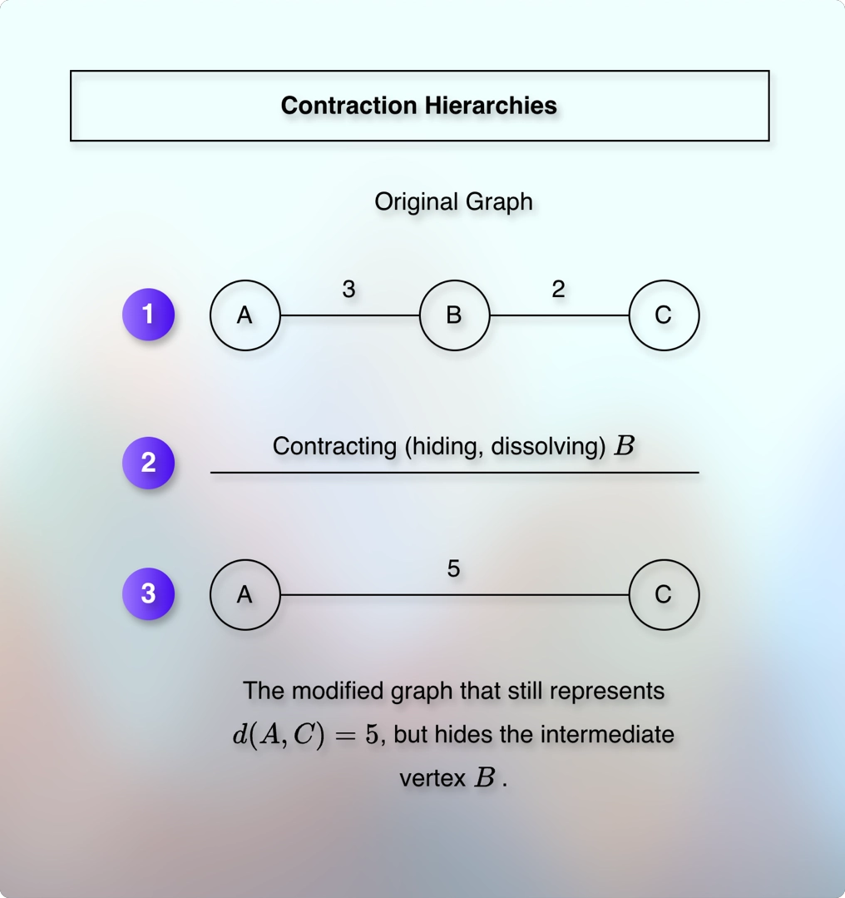
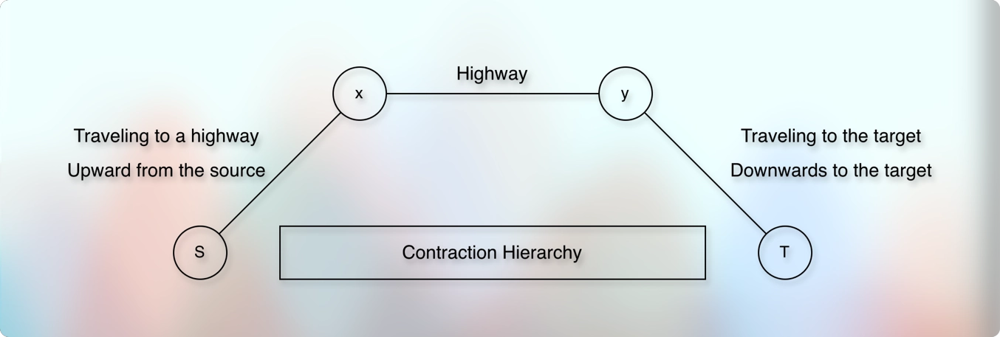
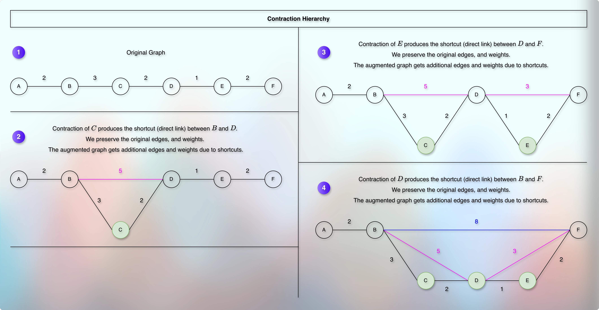
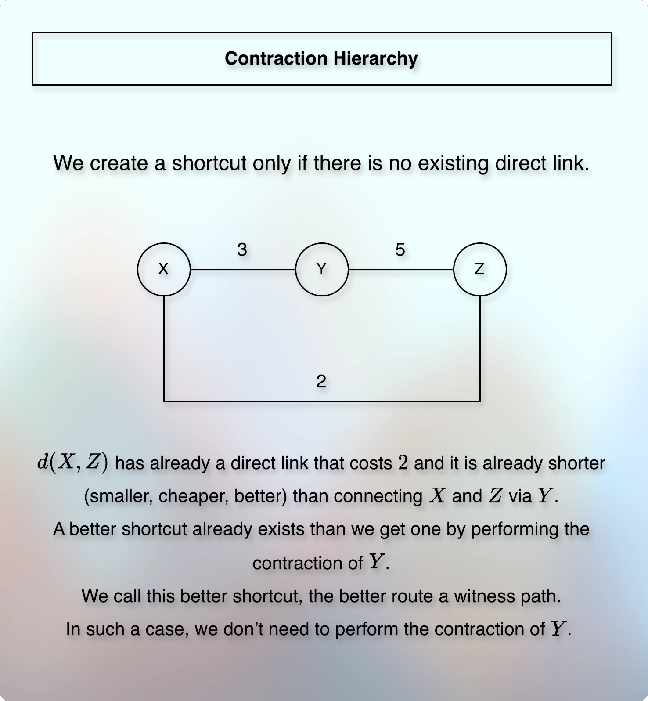

# Contraction hierarchies and node importance

---

**References**

* [Illustrative Contraction Hierarchies By System Underground](https://youtu.be/xe1CbmJfMcU)

---

* The main purpose of the contraction hierarchy is to preprocess and prepare the map beforehand so that finding the shortest path becomes faster.
* We need to preprocess and prepare the map beforehand for the multiple queries.
* We don't know the future source and the future target.
* And there can be different source and target for different queries.
* So, how do we preprocess and prepare the graph (map, network)?

---

* We compare contraction hierarchies with a flyover (overpass).

* The first and the third image represent the idea.
* Suppose that there are 10 vertices between a source and a target.
* We find the shortest path between this source and the target.
* We store this information.
* Later, when we ask (once or frequently), we do not have to recalculate it every time at runtime on demand.
* We compare this with an analogy where we travel from a source to a destination via a flyover (overpass, highway) instead of going through the local villages, tolls, and signals.
* If such a 
* So technically, what do we do? 
* And how do we do it?

---

* What happens when we travel from our home, which is in a different state to a friend's home, which is in another state?
* We start with the local streets, then enter into a highway, then a bigger highway, maybe an interstate highway. 
* And as we reach closer to the friend's home, we enter into the smaller highway, and eventually, into the local streets.
* This is the general pattern and inspiration for the intuition.

1. Leave residential street.
2. Enter into the main road.
3. Join a state highway.
4. Join a national highway.
5. Leave the highway as we reach near the destination.
6. Travel through the local roads to reach the destination.

* The journey starts and ends on local roads.
* But the long distance journey happens on highways.
* We can classify them roughly as:

1. Local roads near the source and destination.
2. Regional roads that connect highways.
3. Highways that cover the major distance.

* We want to focus on the highway that connects the regional road that connects the local road to the source and the destination.
* But how do we apply this filter?
* Based on the importance.
* We want to focus on the local roads near the source that connect regional roads that connect highways that connect regional roads towards the target that connect the local roads near the target.
* If a local road near the source does not connect a regional road or a highway that can reach the target, it is not important to us.

---

* How do we assign the importance?
* Highways cover the most distance. So, they get the highest importance.
* Regional roads that connect highways get the middle importance.
* Local streets that connect regional roads get the lowest importance.

---

* How do we find (evaluate, calculate, determine, define, and assign) the importance? 

---

* Suppose that `V` represents the locations (vertices).
* And `E` represents the roads (edges) that connect these locations (vertices).
* These `V` and `E` are parts of our graph, `G`.

$$
G = (V, E)
$$

* And if `u` and `v` are two locations, then the cost of traveling from `u` to `v` is:

$$
w(u, v)
$$

* The cost can be any unit.
* Such as distance, fuel, price, toll-tax, time, etc. 

---

**Contraction Hierarchies**

* What if we preprocess the graph to find the shortest path?
* But we don’t know the source and the destination beforehand.
* Also, there can be millions of vertices.
* It is not feasible to find the shortest path for all the vertices from all the other vertices.
* The concept we use to solve the problem is called contraction hierarchies.
* We virtually remove intersections, obstacles, stops, etc.
* But we preserve the path.
* We assign a rank to each vertex based on the importance.
* We record an order in which the vertices are visited.
* We do this for all the vertices, for the entire graph.
* This process is called preprocessing.

---

* In contraction hierarchy, we contract (hide) an unimportant vertex (like vertex B in the image) and connect its neighbors directly (like A and C in the image).
* Here, the term hierarchy represents ranking of nodes from least important to most important.
* The idea is:
* Identify the least important intersections.
* Bypass them.
* For example, the vertex B in the image.
* Do not destroy the shortest route.
* For example, $d(A, C)$ is still $5$.
* We do not delete or remove the vertex, $B$.
* We just hide it.
* The vertex $B$ is the part of the route (path) $AC$.
* The path $AC$ goes through $B$.
* If we remove (delete) the vertex $B$ in reality, then we break the route $AC$.
* Also, we cannot delete a vertex arbitrarily.
* Because for some query, $B$ can be a source, a destination, or a part of the path.
* So, we don't delete the vertex $B$.
* We just hide it.
* We call it **vertex contraction** or **node contraction**.
* After the vertex contraction, we may need to create a shortcut.
* Creating the corresponding shortcut is a possible consequences of the vertex contraction.
* For example, after we contract (hide) the vertex $B$, creating a shortcut that connects the vertex $A$ and $C$ is essential.
* The shortcut must preserve the original cost.
* For example, the shortest path $d(A, C)$ from $A$ to $C$ that goes via $B$ in the original graph costs $5$.
* So, in the modified graph also, after contracting (hiding) $B$ and creating the shortcut (direct connection) $AC$, the shortest path $d(A, C)$ still costs $5$.
* However, sometimes the vertex contraction does not require creating a shortcut.

---

* The order in which we select and perform contractions on the vertices matter.
* It can change the shortcuts (start-vertex and end-vertex), the number of shortcuts, the number of edges in the augmented graph, preprocessing time and efficiency, etc.
* For the efficient order, we use node importance (rank).
* For example, a road that connects a highway is more important than the road that connects a small local street.
* We generally contract the less important vertices first.
* The vertices that we contract before (earlier) get lower ranks.
* The vertices that we contract later get higher ranks.
* In this way, the rank of a vertex $r(v)$ represents the position of the vertex in the contraction order.
* We may or may not know the importance (rank) of each vertex in advance.
* But we estimate it using the characteristics of the graph.
* How?

---

* Which vertices do we identify as intersections?
* Based on the importance (rank).
* How do we define and assign the importance (rank)?
* How do we ensure that we do not destroy the shortest route?

---

* Contraction hierarchies do not discover and identify intersections.
* It is something that we get beforehand as a part of the input.

|    Real-world element   |    Graph representation    |
|:-----------------------:|:--------------------------:|
| Road intersection       | Vertex                     |
| T-junction              | Vertex                     |
| Roundabout connection   | Vertex or several vertices |
| Road segment            | Edge                       |
| Travel time or distance | Edge weight                |
| One-way road            | Directed edge              |

* We generally create vertices at locations that matter for routing, such as:
* Road junctions
* Changes in connectivity
* Road endpoints
* Places where a route can enter or leave a road
* Places that change the route
* Etc.

* The exact graph construction is a separate preprocessing step that happens before contraction hierarchies.

---

* The goal is to prepare a preprocessed map that knows important routes (paths) vs. unimportant routes (paths).
* How do we define and assign important vs. unimportant paths?
* How do we define and assign ranks?
* Do we define and assign ranks based on the distance (edge weight)? How?
* Does the higher edge weight get the higher rank?
* How do we use ranks?
* How do we treat different ranks?
* How does the map treat and use different ranks?

---

* Do we take the least important intersections, and hide them?
* Does it mean that we hide the vertices with the lowest rank?
* How do we hide/bypass/treat vertices or edge-weights with the lowest ranks?
* What if a vertex is a part of the shortest path? Do we still hide it? How? Why?
* What does it mean by building/creating a direct mathematical bridge/shortcut? How does it help? When do we do that? Why do we do that? How do we do that?
* In which case a vertex contraction does not require creating a corresponding shortcut? Why?
* When do we skip building/creating a shortcut? Why?
* Suppose that the original graph has edge(A, B) with weight 3, edge(B, C) with weight 2.
* Now, do we preprocess the graph such that it answers:
* "The shortest path from A to C goes via B and A to C costs 5".
* If yes, how?
* If no, then what does it answer? How?
* Can we say that the preprocessed graph (map) is a zoomed out version of the original graph (map)?
* If yes, then how does it help?
* Do ranks act as a guide for the search? How?
* How does the representation of the shortest path as upward from the source and downward to the target help? Why isn't it a linear path?

---

* What is a witness search?
* What is a witness path?
* For the given contraction example of 2-6-1-4-3-5, where the edge weight is 2,3,2,1,2 respectively:
  * Why didn't we perform contraction of `6` that could have created the direct connection (shortcut) between `2` and `5` with cost `10`?
  * We performed the contraction of `2`, but not for `6`. Was it possible (legal) to perform the contraction of `6` before `2`? Why? 
* Do we add the shortcut only if there is no existing direct connection (link)?
* Do we add the shortcut if the direct connection (link) between two vertices has larger value than the alternate route via one or more vertices? 
  * For example, suppose that `edge(u, v)` is `3`, `edge(v, w)` is `2`, and `edge(u, w)` is `8`.
  * Here, the direct connection (link) between `u` and `w` already exists.
  * But it is costlier than the alternate route that connects `u` and `w` via `v`.
  * So, do we perform contraction on `v` and add a shortcut (direct link) `edge(u, w)` that costs `5`? Why?
* Does witness path mean direct connection (link)?
* Isn't it true that finding the witness path to decide whether we need to create a shortcut or not means running Dijkstra from one vertex to another vertex? And we might do it for all the vertices. And in this way, isn't it expensive as we might run Dijkstra on each vertex instead of one fixed source and one fixed target? Doesn't it seem to be exponential (polynomial) as we might run Dijkstra $V^2$ times?
* 
---

**Recap**

* We imagine the idea of contraction hierarchies as a flyover (overpass).
* The term “contraction” refers to the process of reducing the number of nodes in a graph.
* We hide less important nodes and edges, making the graph simpler.
* But they are still there, just hidden.
* The term “hierarchies” refers to the process of organizing nodes based on their importance.
* To organize nodes based on their importance, we use ranks.
* We use ranks to guide the search process.
* We imagine the search process as moving upwards from the source and downwards towards the target.
* Moving upwards from the source indicates moving through the higher-ranked nodes.
* Similarly, moving downwards towards the target indicates moving through the lower-ranked nodes.

--- 