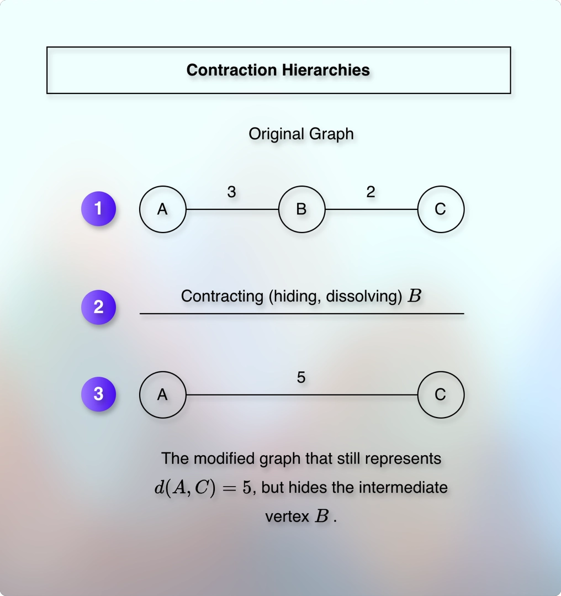

# Highway hierarchies and node importance

---

* What happens when we travel from our home, which is in a different state to a friend's home, which is in another state?
* We start with the local streets, then enter into a highway, then a bigger highway, maybe an interstate highway. 
* And as we reach closer to the friend's home, we enter into the smaller highway, and eventually, into the local streets.
* This is the general pattern and inspiration for the intuition.

1. Leave residential street.
2. Enter into the main road.
3. Join a state highway.
4. Join a national highway.
5. Leave the highway as we reach near the destination.
6. Travel through the local roads to reach the destination.

* The journey starts and ends on local roads.
* But the long distance journey happens on highways.
* We can classify them roughly as:

1. Local roads near the source and destination.
2. Regional roads that connect highways.
3. Highways that cover the major distance.

* We want to focus on the highway that connects the regional road that connects the local road to the source and the destination.
* But how do we apply this filter?
* Based on the importance.
* We want to focus on the local roads near the source that connect regional roads that connect highways that connect regional roads towards the target that connect the local roads near the target.
* If a local road near the source does not connect a regional road or a highway that can reach the target, it is not important to us.

---

* How do we assign the importance?
* Highways cover the most distance. So, they get the highest importance.
* Regional roads that connect highways get the middle importance.
* Local streets that connect regional roads get the lowest importance.

---

* How do we find (evaluate, calculate, determine) the importance? 

---

* Suppose that `V` represents the locations (vertices).
* And `E` represents the roads (edges) that connect these locations (vertices).
* These `V` and `E` are parts of our graph, `G`.

$$
G = (V, E)
$$

* And if `u` and `v` are two locations, then the cost of traveling from `u` to `v` is:

$$
w(u, v)
$$

* The cost can be any unit.
* Such as distance, fuel, price, toll-tax, time, etc. 

---

**Contraction Hierarchies**

* What if we preprocess the graph to find the shortest path?
* But we don’t know the source and the destination beforehand.
* Also, there can be millions of vertices.
* It is not feasible to find the shortest path for all the vertices from all the other vertices.
* The concept we use to solve the problem is called contraction hierarchies.
* We virtually remove intersections, obstacles, stops, etc.
* But we preserve the path.
* We assign a rank to each vertex.
* We record an order in which the vertices are visited.
* We do this for all the vertices, for the entire graph.
* This process is called preprocessing.

---

* The idea is:
* Identify intersections.
* Bypass them.
* Do not destroy the shortest route.

---

* Which vertices do we identify as intersections?
* How do we ensure that we do not destroy the shortest route?

---

* Contraction hierarchies do not discover and identify intersections.
* It is something that we get beforehand as a part of the input.

|    Real-world element   |    Graph representation    |
|:-----------------------:|:--------------------------:|
| Road intersection       | Vertex                     |
| T-junction              | Vertex                     |
| Roundabout connection   | Vertex or several vertices |
| Road segment            | Edge                       |
| Travel time or distance | Edge weight                |
| One-way road            | Directed edge              |

* We generally create vertices at locations that matter for routing, such as:
* Road junctions
* Changes in connectivity
* Road endpoints
* Places where a route can enter or leave a road
* Places that change the route
* Etc.

* The exact graph construction is a separate preprocessing step that happens before contraction hierarchies.